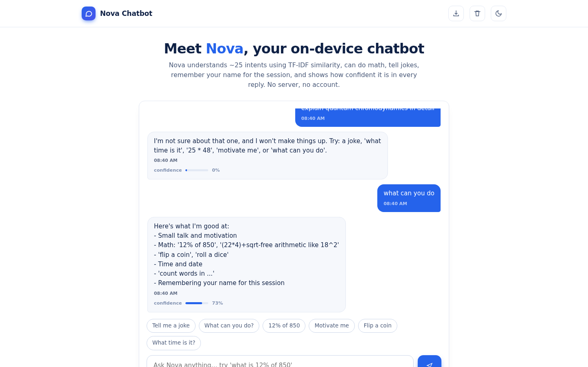
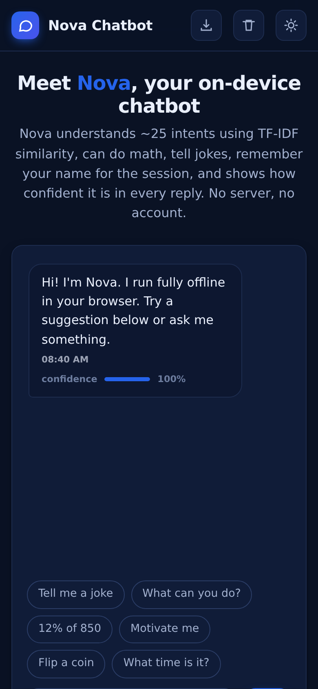

# Nova Chatbot

A friendly chatbot that runs completely in your browser. It understands about 25 intents through TF-IDF similarity, does real math, tells jokes, remembers your name for the session, and shows a confidence score on every reply so you always know how sure it is.

**Live demo: https://akash991833.github.io/ai-chatbot/**



## Features

- **TF-IDF intent matching** - every message is scored against 25 intents with multiple training phrases each; low confidence gets an honest "I'm not sure" instead of a made-up answer.
- **Real utilities** - percentage and arithmetic evaluation (`12% of 850`, `25 * 48`, `18^2`), time, date, word counting, coin flip, dice.
- **Session memory** - tell Nova your name and it remembers it until you close the tab.
- **Jokes and motivation** on demand.
- **Per-reply confidence bar** so the model's certainty is visible.
- **Suggestion chips, typing indicator, timestamps, chat export, clear chat.**
- **Dark and light mode**, mobile friendly, installable PWA, works offline.



## Honest limits

Nova is a classic intent-matching chatbot, not a large language model. It answers what it was designed for and declines the rest instead of hallucinating.

## Tech

Vanilla HTML/CSS/JS. The whole brain (TF-IDF engine, intents, entities) is one readable `app.js`. No servers, no tracking.

## Run locally

```bash
python3 -m http.server 8000
```
